  <a href="https://jhviw.github.io"><b>Website</b></a> &nbsp;·&nbsp;
  <a href="https://cs2locker.com"><b>CS2Locker</b></a> &nbsp;·&nbsp;
  <a href="https://www.linkedin.com/in/rickviwaarden"><b>LinkedIn</b></a> &nbsp;·&nbsp;
  <a href="https://jhviw.github.io/docs/cv.html"><b>CV</b></a> &nbsp;·&nbsp;
  <a href="mailto:rick@saltdevelopment.nl"><b>rick@saltdevelopment.nl</b></a>

I'm a software developer and AI Lead based in Tilburg, specialising in **AI, cybersecurity and software for healthcare**.

At [Bodegro](https://www.bodegro.com/) I work full-time on LabTrain, a laboratory information system for the healthcare sector, while leading the responsible introduction of AI across the organisation — running pilots, building LLM tooling, and shaping governance with security and privacy as hard requirements. On the side I build and run [CS2Locker](https://cs2locker.com), a production platform with live market data and thousands of daily visitors.

 

### Now

| Since | Role | Focus |
|---|---|---|
| 2024 | **Software Developer & AI Lead** · [Bodegro](https://www.bodegro.com/) | LabTrain LIS in C#/.NET, ASP.NET and Oracle PL/SQL with HL7/FHIR integrations; AI pilots, LLM tooling and AI governance |
| 2025 | **Founder & Lead Developer** · [CS2Locker](https://cs2locker.com) | A production platform with live data from 20+ marketplaces |
| 2025 | **Owner** · Salt Development | Web applications and digital products |

 

### CS2Locker

A production platform for the CS2 skin market — built and operated end-to-end, from market ingestion to edge delivery.

<b>Architecture</b>

 

| Layer | Details |
|---|---|
| **Frontend** | Nuxt 3 SSR — 185 Vue components, 58 composables, 34 pages (EN + RU i18n) |
| **Data** | PostgreSQL via PgBouncer, dynamic pool sizing, prepared statements, `DISTINCT ON` optimisation |
| **Integrations** | Steam, CSFloat, Buff163, DMarket, Skinport, Waxpeer and more via NDJSON streaming with exponential backoff |
| **Real-time** | Live deals over Server-Sent Events, web-push (VAPID / RFC 8030), 3D skin viewer in Three.js |
| **Security** | Steam OpenID 2.0, Stripe webhooks (HMAC-SHA256), signed httpOnly sessions, role-based tiers |
| **Operations** | Multi-tier caching (in-memory, Nitro ISR, Cloudflare edge), automated CDN purge, hourly cron pipelines |

 

### Research & tools

| Project | Type | About |
|---|---|---|
| [**OSINT & Phishing Awareness**](https://jhviw.github.io/osint-phishing-awareness/) | Research | An OSINT investigation combined with a phishing awareness campaign, from methodology to recommendations (NL). |
| [**Unmasking the Cheats**](https://jhviw.github.io/research/cve_research.html) | Article | Counter-Strike 2 vulnerabilities (CVE-2021-30481), how wallhacks work, and how to mitigate them. |
| [**OV Vertrektijden**](https://jhviw.github.io/ov-vertrektijden/) | Web app | Live Dutch public-transport departure board for trains and bus stops. |
| [**Bushalte API**](https://jhviw.github.io/bushalte-api/) | Tool | Client-side search over a dataset of Dutch bus stops. |
| [**Minecraft Palette Generator**](https://jhviw.github.io/MinecraftSites/ColorPaletteGenerator.html) | Tool | Block colour-palette and pattern designer for Minecraft builders. |

 

### Stack

| Area | Tools & practices |
|---|---|
| **AI & automation** | Python · LLM tooling · Prompt engineering · AI governance |
| **Backend** | C# / .NET · ASP.NET Web API · Node.js · TypeScript · PostgreSQL · Oracle PL/SQL · Docker · CI/CD |
| **Frontend** | Vue 3 / Nuxt · React · Tailwind · Razor / Blazor · Three.js |
| **Security** | Secure coding · OWASP Top 10 · Pentesting · CTFs · OSINT · Responsible disclosure |
| **Healthcare & integration** | NEN 7510 / 7513 · HL7 / FHIR · OAuth · Stripe · Cloudflare · SSE / WebSockets |

 

HBO-ICT Software Engineering, specialisation Cybersecurity — Fontys, Tilburg (2022–2026) &nbsp;·&nbsp; Dutch · English (C1) · German · French (B1)
